# VTL Taskforce

## Rome meeting

### Trevas tools

---

# Context

--

## Insee's strategy

- Align on international standards
- Active metadata all along the statistical process
- Embrace open data and open source
- Using VTL and creating Trevas in line with this

--

## VTL use cases

- Create and apply data controls for web surveys
- Reconcile multimode household survey data
- Validate administrative data

--

## Trevas history

- Development started in May 2020
  - ESSnet on sharing services
  - Collaboration with Statistics Norway
- Sponsored by Insee, CASD and Making Sense
- Today in v1.1.1 after 1156 commits

--

## Trevas today

- A collection of tools
  - Java engine, lab, notebook, API, batch
  - JavaScript engine, editor
- Published as open source
- Available on public repositories

---

# Demo

--

## Business example

### What percentage of dwellings had a moving in 2020?

Datasets:

- Dwellings (69 columns, 25 520 281 rows), overseas departments merged
- Movings (64 columns, 9 691 803 rows), overseas departments separated

--

## Flowchart

--

[Start](http://trevas.info/)

---

## Thank you

## Questions?
