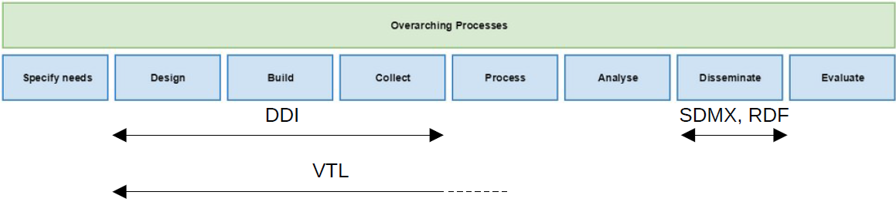
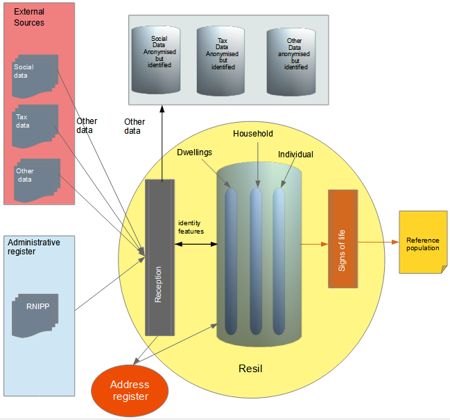
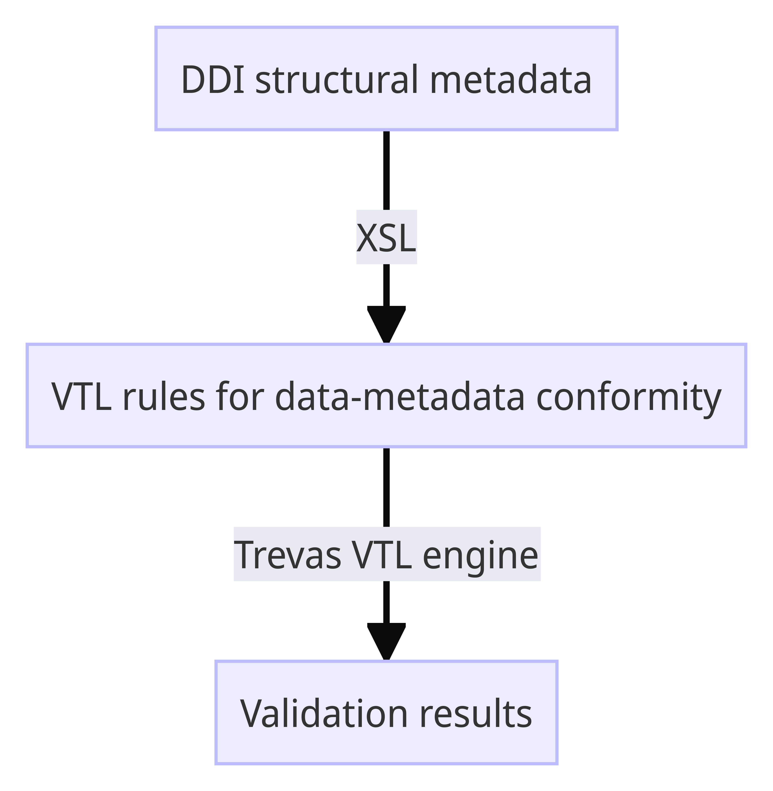
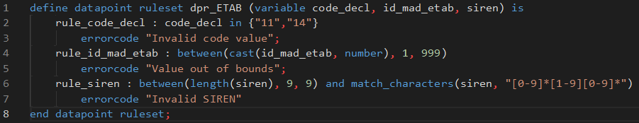

## SDMX Global Conference 2023

### Insee presentation

#### Using data description to automate validation with VTL

---

# Insee Context

--

## Metadata strategy

- Align on international standards
- Active metadata all along the statistical process
- Embrace open data and open source

--

## Metadata standards

- DDI for questionnaires and variable-level documentation
- SDMX for dissemination
  - Dissemination of time series by API
  - Automation of data dissemination
- VTL for data validation
  - Data controls and flow logic for web surveys
  - Reconcile multimode household survey data
  - Validate administrative data

--

## Metadata standards and GSBPM

Generic use of standards in statistical process

--

## Zoom on VTL

- Validation and Transformation Language
- Published by the SDMX initiative
- Desirable features
  - Business-oriented, independent of technology
  - Formal grammar → automatable

---

# Use case

--

## The Résil system

Build a statistical register of individuals and dwellings based on the linkage of various administrative data

See also [ISI presentation](https://www.isi2023.org/abstracts/submission/1611/view/)

--

## Main objectives

- Automation of administrative data ingestion and validation
- Documentation of:
  - Data ingested
  - Validation rules

--

## Workflow

- Documentation of administrative data with DDI
- Generation of data model for data ingestion
- Ingestion of data
- Generation of VTL validation rules from DDI
- Execution of VTL validation rules

---

# Implementation

--

## Technical workflow

- DDI structural metadata
  - Entered in Colectica system
  - Exported in XML
- Java-driven XSL [transformation](https://github.com/Making-Sense-Info/Dvorak)
  - Produces VTL `ruleset` objects
- [Trevas](http://trevas.info/) VTL engine
  - Runs validation script
  - Provides datasets of results

--

## Technical workflow

--

# Examples

---

# Conclusion

--

## Proof of concept conclusive

- Activation of structural metadata
- Seamless insertion in statistical process
- Value added in terms of quality
  - Better documentation of data and treatments
  - Coherence, traceability, adaptability

--

## Thank you

## Any questions?
