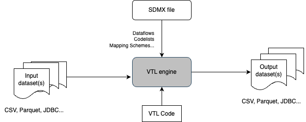
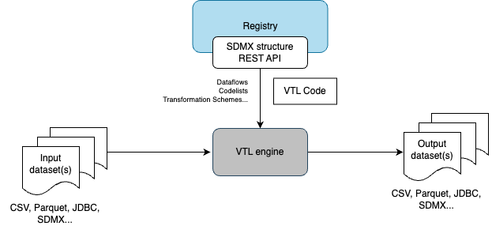

## UNECE workshop

### Paris

## SDMX / VTL with Trevas

---

## [BPE](https://www.insee.fr/en/metadonnees/source/serie/s1161) use case

### Permanent Database of Facilities

--

--

- (1) validation of municipality code in input file
- (2) clean BPE input database
- (3) BPE aggregation by municipality, type and year
- (4) BPE aggregation by NUTS 3, type and year
- (5) BPE validation of facility types by NUTS 3
- (6) prepare 2021 census dataset by NUTS 3
- (7) extract dataset on general practitioners from BPE by NUTS 3 in 2021
- (8) merge practitioners & legal population datasets by NUTS 3 in 2021 and compute an indicator

---

## Technical overview

--

#### v1 - Operational today in Trevas

--

#### v2 - Possible extensions

---

## Resources

- [Trevas](http://trevas.info/)
- Detailled [BPE use case](https://github.com/InseeFr/Trevas/blob/feature/sdmx/vtl-sdmx/src/test/resources/BPE.md)
- [SDMX technical notes](https://sdmx.org/wp-content/uploads/SDMX_3-0-0_SECTION_6_FINAL-1_0.pdf) (see chapter 12)

---

## Thank you

## Questions?
