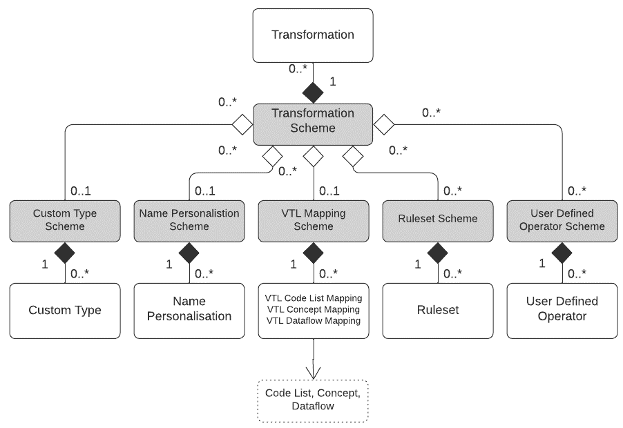
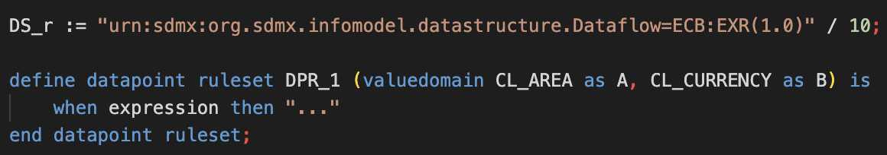
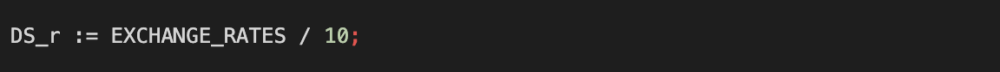
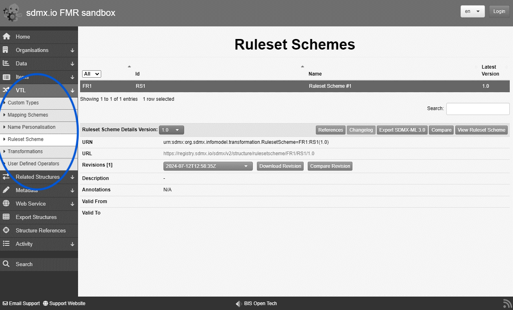
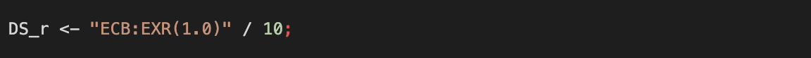
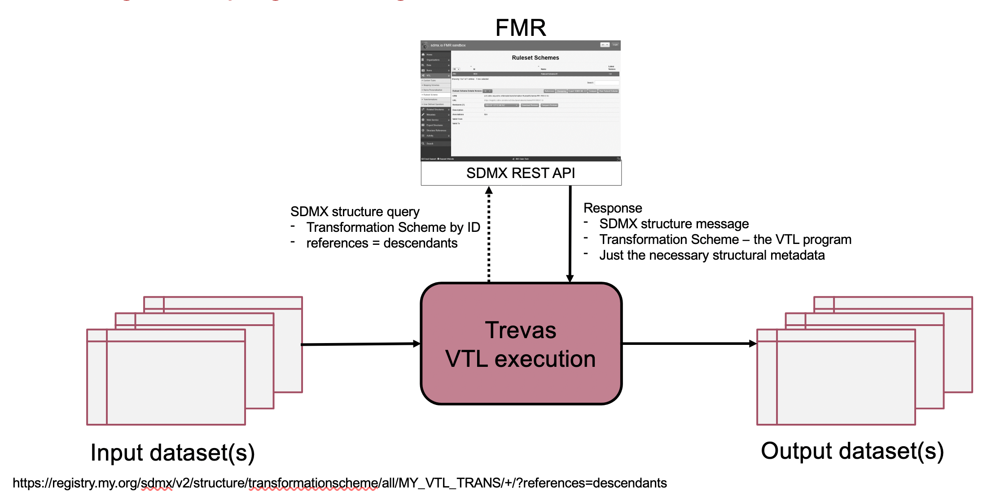
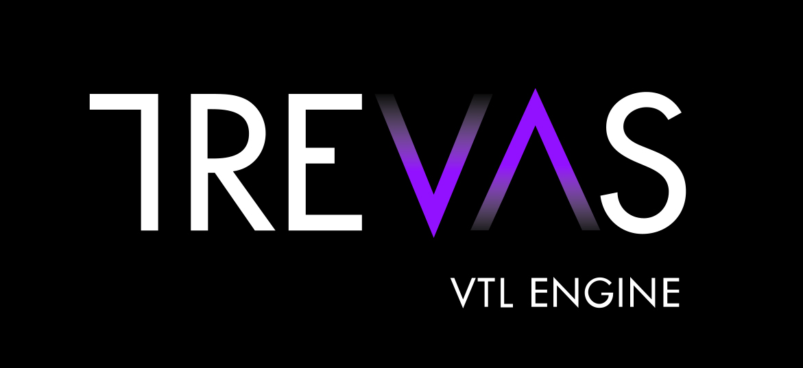
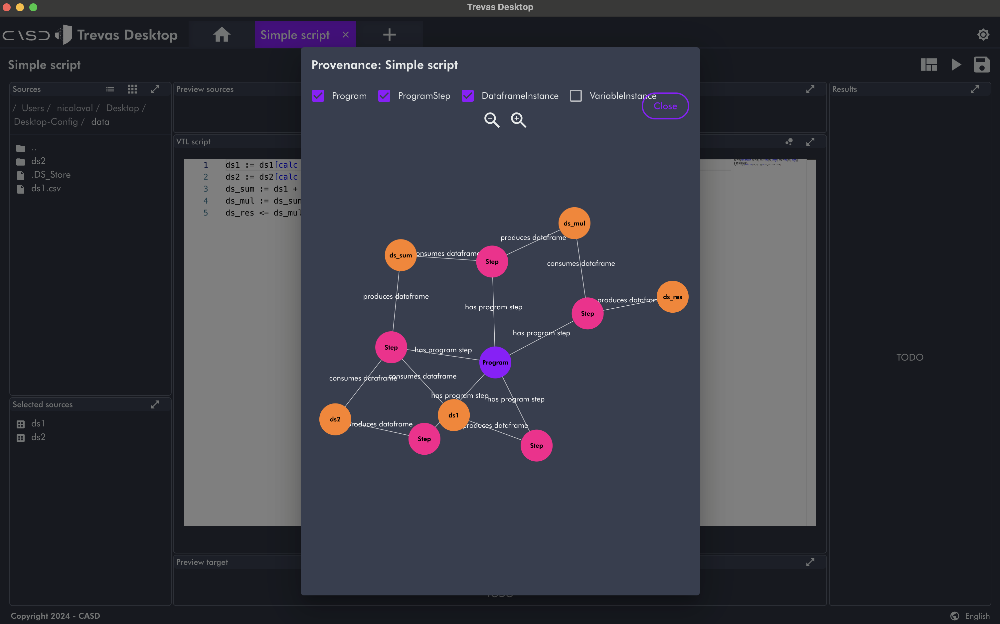

# A practical SDMX / VTL implementation using Trevas and FMR

Glenn Tice, BIS Monetary and Economics IT / Nicolas Laval, Lead tech - Making Sense

2024 SDMX Experts Workshop

---

## VTL integration with SDMX

--

- VTL has its own information model based on GSIM, but is designed to be compatible with SDMX and other standards like DDI
- The [SDMX Section 6 Technical Notes](https://sdmx.org/wp-content/uploads/SDMX_3-0-0_SECTION_6_FINAL-1_0.pdf) explains how VTL and SDMX work together
- Two important elements for a practical implementation are:
  - How VTL programs can be stored and exchanged together with the SDMX structures of the datasets involved
  - How SDMX artefacts can be referenced in VTL code as inputs and / or outputs of Transformations and for validation Rules

--

## Storage and exchange of VTL

- In the SDMX context, VTL code is managed as structural metadata
- The SDMX information model provides several artefacts for this purpose
- Centres on the **Transformation Scheme** artefact which **encapsulates a VTL program**
- Allows VTL to be stored and exchanged in the same way as other SDMX structures

--

## Referencing SDMX artefacts in VTL Statements and Rules

- SDMX artefacts can be referenced in VTL code using full or partial URNs

- Or, by user defined aliases defined using VTL Mapping Schemes which allow SDMX artefacts to be given symbolic names

--

## FMR support for storage and exchange of VTL

- All VTL structures supported in FMR 11
- VTL syntax checking on structure submission
- Basic authoring and maintenance using the FMR web user interface
- Better VTL code development environments can interface to the FMR repo by the REST API

--

## FMR support for referencing SDMX artefacts in VTL code

#### Deep structure cross referencing

- FMR identifies SDMX artefacts referenced by full or partial URN in the VTL code
- Manages them as structural metadata cross references

#### Why?

- Execution engines can efficiently retrieve both the VTL program and structural metadata for input datasets and validation rules in a single REST web service call for the Transformation Scheme with `references=descendants`
- Enforces metadata referential integrity

--

## FMR support for referencing SDMX artefacts in VTL code - Example

- A Transformation Scheme is constructed with a single Transformation

On submission of the Transformation Scheme to the metadata registry, FMR will:

- Syntactically analyse the VTL code
- Identify ECB:EXR(1.0) as an SDMX partial URN
- Infer that it is a Dataflow from the code context
- Verify that the Dataflow exists in the registry
- Create a cross reference to the Dataflow from the Transformation Scheme
- Store the Transformation Scheme

--

## Executing a VTL program using Trevas and FMR

---

## 

- Java VTL engine
- Distributed computing (Apache Spark)
- Open source
- Modular

--

## Trevas open source galaxy

- Trevas [ecosystem](http://trevas.info/introduction/#trevas-ecosystem)
- [Trevas TS](https://github.com/InseeFr/Trevas-JS)

- [VTL editor](https://making-sense-info.github.io/ANTLR-Editor/)

--

## VTL 2.1

Tools updated with VTL 2.1 grammar:

- [Vtl Editor](https://making-sense-info.github.io/ANTLR-Editor/?path=/story/vtleditor-2-1--new-features)
- [Trevas](http://trevas.info/blog/trevas-vtl-21)
- [Trevas TS](https://github.com/InseeFr/Trevas-TS?tab=readme-ov-file#trevas-ts)
- Trevas Jupyter

Trevas engines VTL 2.1 support:

- ✅ random
- ✅ case
- ❌ Time operators

--

## Building solutions with Trevas

Example:

- Desktop app
- Validating data using DDI

_[CASD](https://www.casd.eu/en/) - Secure Data Access Center_

---

## [Permanent Database of Facilities](https://www.insee.fr/en/metadonnees/source/serie/s1161)

### Insee VTL/SDMX use case

--

--

- (1) validation of municipality code in input file
- (2) clean BPE input database
- (3) BPE aggregation by municipality, type and year
- (4) BPE aggregation by NUTS 3, type and year
- (5) BPE validation of facility types by NUTS 3
- (6) prepare 2021 census dataset by NUTS 3
- (7) extract dataset on general practitioners from BPE by NUTS 3 in 2021
- (8) merge practitioners & legal population datasets by NUTS 3 in 2021 and compute an indicator

--

### Use case in action

- [Trevas Jupyter](https://github.com/Making-Sense-Info/Trevas-Jupyter)
- [Onboarding sample](https://github.com/Making-Sense-Info/Trevas-Jupyter-Training)

---

## Next steps

--

## Open collaboration,

### beneficial for all

- BIS: lessons learned from PoC & tune the VTL metadata functionality if needed
- Making Sense: improve Trevas SDMX support
- UNSD: PoC VTL integration

---

## Thanks
